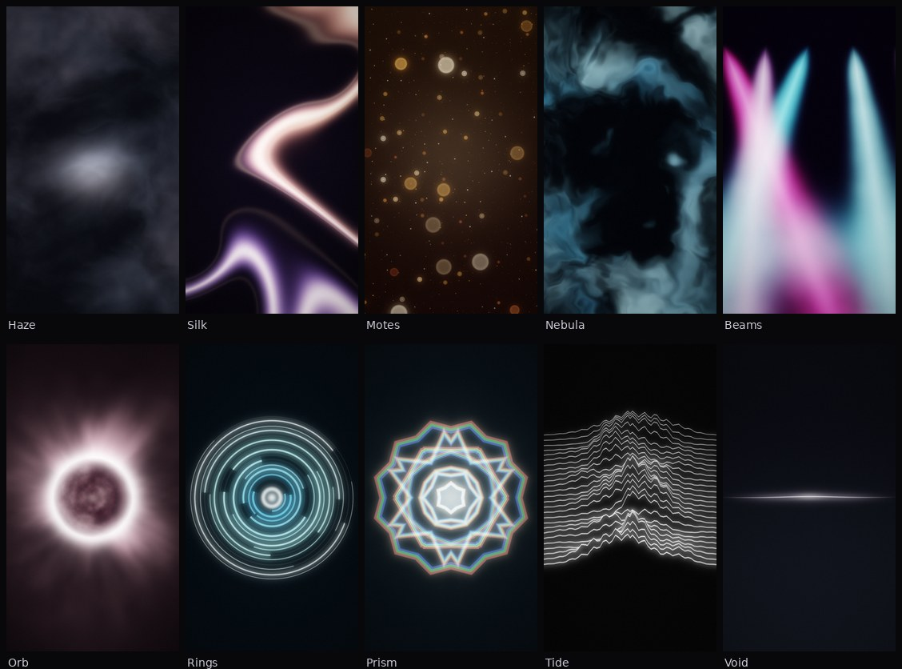
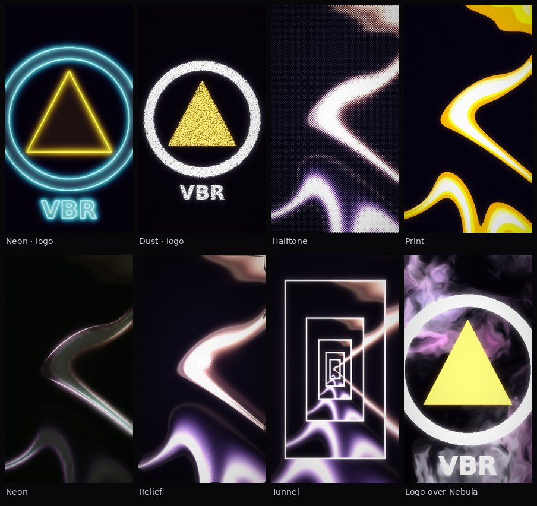

# Vibrations — music visualiser

An Android music visualiser for personal listening and for making artwork videos, loops and stills.
It's soft and atmospheric by default, with crisp output when you export.



This folder is self-contained so it can be moved to its own repository later.

## Your artwork



Tap the **Art** button and add your own image: an album cover, a photo, a drawing, or a transparent PNG logo. You can also share an image to Vibrations from any app.

- **Up-res**: the image is enlarged to the output size with Catmull-Rom bicubic resampling, then an edge-preserving smooth and contrast-adaptive sharpening pass cleans it up. **Save image 2× / 4×** exports the enhanced PNG (up to 4096 px) to `Pictures/Vibrations`. This is classical image processing, not AI super-resolution, so it makes small images crisper but won't invent detail.
- **Ten art modes** (swipe left/right to change):
  - **Neon**: the picture redrawn as glowing tubes along its contours, with light travelling through them and kicks flashing them.
  - **Breathe**, **Liquid**, **Ripple** and **Split**: the picture itself pushed, melted, rippled or channel-split by the music.
  - **Halftone** and **Print**: a printed dot screen, or a screen-print in palette inks.
  - **Relief**: brightness becomes depth, under a moving light.
  - **Dust**: the picture breaks into points of light.
  - **Tunnel**: the picture framed inside itself, falling forward.
- **Neon controls**: line weight, contour detail, and how much of the picture stays under the lines.
- **Picture controls**: effect amount (dry/wet), fit (crop ↔ whole), palette colours (re-ink the art with any palette), and scene behind (any scene shows through transparent or dark areas).
- **Art palette**: five colours taken from your image become an "Art" palette that every scene can use.
- Symmetry, trails, glow, recording, loops and stills all work on artwork too.

## Features

- **Ten scenes** covering light, fluid, particle, geometric, graphic and minimal styles: Haze (the default ambient field), Silk, Motes, Nebula, Beams, Orb, Rings, Prism, Tide and Void (near-empty, for minimal artwork). Scene changes crossfade.
- **Eleven palettes**. Some are luminous (Pearl, Glacier, Rose…) and some punchy (Neon, Acid, Solar); a punchy palette uses a more contrasty tone curve. Palette changes blend smoothly.
- **Audio**: open a track (decoded on the device, gapless repeat, seek), use the microphone, or run in ambient mode with no input. The visuals react to bass, mids, highs, the spectrum and detected kicks. Analysis lines up with the speaker's playback position, so kicks land on the beat despite output-buffer latency.
- **Motion keeps going in quiet sections**. All motion runs on its own clock, and loud passages push it gently forward.
- **Recording**: one tap records H.264 video with AAC audio to `Movies/Vibrations`. The picture is always clean: the UI never appears in exports.
- **Aspect presets**: Full, 16:9, 9:16 and 1:1, at 720p or 1080p and 30 or 60 fps. Sizes are checked against the device's encoder.
- **Loop clips (4, 6, 8 or 12 s)**: loop mode makes all motion periodic. Recording then captures exactly one cycle with frame-exact timing, easing the audio response in and out so the clip joins seamlessly. These clips are video-only and ready to convert to GIF.
- **Stills**: saves a PNG of the current frame at output resolution to `Pictures/Vibrations`.
- **Presets**: save the current look by name. Six starting points are built in.
- **Text overlay**: an optional title and single line, rendered into exports, with corner, bottom or centre placement.
- **Look controls**: symmetry (mirror, quad, 6- or 8-fold), trails, glow, grain, motion speed and sensitivity.

## Gestures

| Gesture | Action |
|---|---|
| Tap | Show or hide the control bar (it hides itself after 4 s) |
| Swipe ← → | Next or previous scene |
| Swipe ↑ ↓ | Sensitivity |
| Long press | Look sheet: palette, symmetry, trails and more |
| Double tap | Lock the scene (blocks swipes and scene changes while recording) |
| Two-finger hold | Hold to soften the response for a more atmospheric take |

"Soft response" can also be latched on in the Look sheet. While you record, the bar shows a quick palette strip, and the scene arrows still work unless the scene is locked. "Hide all controls while recording" (on by default) leaves the screen completely clean.

## Build

Requirements: JDK 17+ and the Android SDK (platform 35, build-tools 35). Set `sdk.dir` in `local.properties` or set `ANDROID_HOME`.

```bash
./gradlew assembleDebug          # app/build/outputs/apk/debug/app-debug.apk
./gradlew assembleRelease        # minified; signed with the debug key so it installs directly
./gradlew testDebugUnitTest      # FFT, kick detection on a synthetic 120 BPM track, resampler
./gradlew lintDebug
```

Before you publish, replace the release build's debug signing key with a real signing config in `app/build.gradle.kts`.

The app needs Android 11 (API 30) or later and OpenGL ES 3.0.

## Shader preview on desktop

Scenes are plain GLSL ES 3.00 files under `app/src/main/assets/shaders`. Scene and palette definitions live in `assets/scenes.json` and `assets/palettes.json`. A browser (WebGL2) harness runs the same files through the same bloom and composite pipeline:

```bash
npx serve .   # or any static server, then open tools/shader-preview.html?scene=silk&palette=1&animate=1
node tools/render-previews.js out/                               # render a PNG of every scene (Playwright)
node tools/render-previews.js out/ "scene=prism&palette=8&sym=6"  # specific looks
node tools/compile-check.js                                      # compile-check every shader
```

Art modes preview the same way. Point `PREVIEW_IMAGES` at a folder of test images and pass `art=<mode>&img=/ext/<file>`; `enhance`, `fit`, `amount`, `tint`, `behind`, `line`, `fill` and `detail` match the app's sliders:

```bash
PREVIEW_IMAGES=~/pics node tools/render-previews.js out/ "art=neon&img=/ext/cover.jpg&palette=8"
```

Preview query parameters: `scene`, `palette`, `t`, `w`, `h`, `bass`, `kick`, `kickAge`, `mid`, `high`, `level`, `sym`, `bloom`, `grain`, `period`, `animate=1`.

To add a scene: write `vec3 scene(vec2 p)` in `assets/shaders/scenes/<id>.glsl` and add an entry to `scenes.json`. For loop-safe motion, drive all animation through `tph()`, `tdrift()` and `tloop()` from `common.glsl` rather than through `uTime` directly.

## Architecture

```
audio/   TrackPlayer (MediaExtractor → MediaCodec → AudioTrack), MicInput,
         AudioAnalyzer (2048-pt FFT, 32 log bands, auto-gain, spectral-flux kick detection,
         results kept on a timeline keyed by stream position), AudioRing (44.1 kHz stereo
         ring + resampler feeding the recorder, latency-compensated)
gl/      VisualRenderer — scene and/or artwork (up-res → edge map → art mode) → feedback (crossfade + trails) → bloom (¼, ⅛) →
         composite (tone map, grain/dither, text) → canvas → screen / encoder / PNG
record/  ClipRecorder (Surface-input H.264 + AAC → MediaMuxer), MediaSaver (MediaStore)
model/   Catalog (scenes/palettes JSON), Look/Output state, PresetStore
ui/      Line-drawn glyph buttons, chips, sliders and swatches (all views built in code)
```

## Status and known limitations

- The APK builds, unit tests and lint pass, and every shader compiles and renders correctly in the WebGL2 harness. The app has **not yet been run on a physical device**. Recording, mic capture and GPU performance need a real-hardware pass.
- Loop clips are video-only. Convert them to GIF with any tool, for example `ffmpeg -i loop.mp4 -vf "fps=24,scale=720:-1:flags=lanczos" loop.gif`.
- Playback pauses when the app goes to the background. There is no background audio service.
